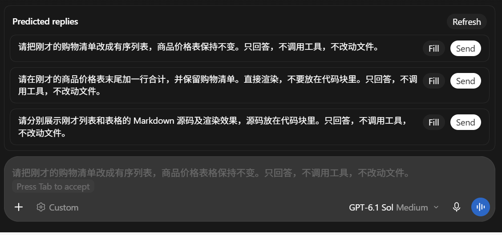
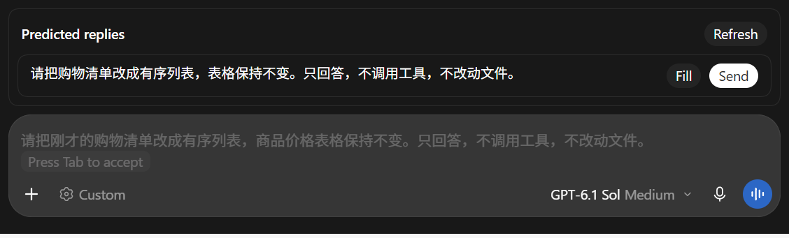
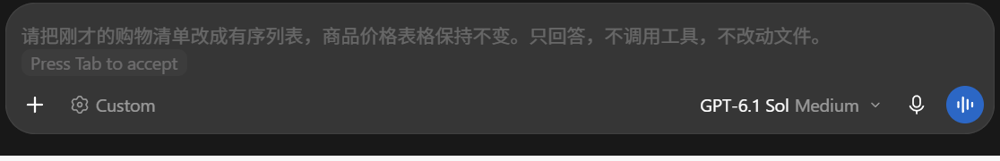

# 回复建议验证记录

2026-10-14，Windows Codex `26.1007.71326`，插件 `0.2.0`。

验证使用独立的本地客户端副本、浏览器配置和测试对话。测试内容是列表、表格和 Markdown 写法。模型返回的是实际生成结果。

| 检查 | 结果 |
| --- | --- |
| 自动显示三条候选 | 输入框上方显示三条实际文本 |
| 换一批 | 返回新的预测分支和候选 |
| 填入草稿 | 实际输入框接受所选文字 |
| 选择发送 | 原生提交函数接受发送，模型完成回复 |
| 建议条数 | 经客户端原生 MCP 设置通道更新，1、2、3 条均自动生成 |
| 关闭候选 | 列表消失，同一条原生灰色预测继续显示 |
| 禁用整个插件 | 候选设置读取返回关闭，原生灰字仍显示 |
| EXE 安装 | 隔离目录完成复制、打包和插件注册，安装出的客户端启动成功 |
| 程序检查 | 23 项 JavaScript 检查、Go 测试和 Go 静态检查通过 |

运行测试通过真实组件、服务和 MCP 协议进行，没有自动点击原生桌面按钮。GUI 安装确认框和桌面快捷方式没有做点击测试。用户正式会话尚未切换到副本。

三条候选：

一条候选：

关闭候选后的原生灰色预测：

可复现入口：`npm run precheck`、`npm run build`。客户端运行测试需先执行 `npm run build:client`、`node scripts/stage-test.mjs` 和 `node scripts/seed-test.mjs`，再执行 `node scripts/launch-test.mjs`、`node scripts/runtime-integration.mjs --send`。安装器设置测试使用 `node scripts/stage-installed-test.mjs`、`node scripts/installed-settings-test.mjs`。

运行测试会调用真实模型。临时数据放在被 Git 忽略的 `work/`，测试截图只保留候选和输入框区域。
